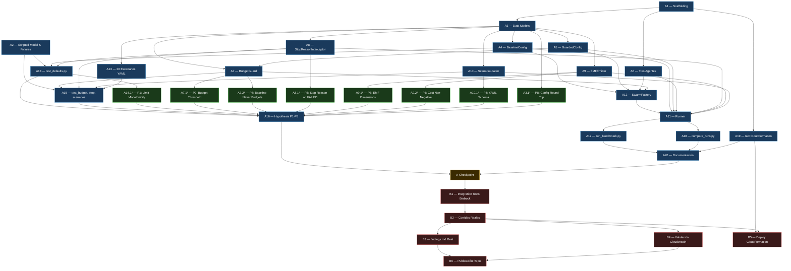

# Implementation Plan: swarm-guard

## Tasks

## Overview

Plan de implementación en dos fases para el benchmark reproducible que demuestra que los controles
de seguridad del patrón Swarm en Strands Agents están desactivados por defecto.

- **Phase A (Offline):** todo el scaffolding, código, tests unitarios y artefactos que no requieren
  credenciales AWS ni acceso a Bedrock. Se puede ejecutar en cualquier máquina.
- **Phase B (Live):** corridas reales con Bedrock en us-east-2, validación de observabilidad en
  CloudWatch y publicación del repo.

---

## Phase A — Offline (No Bedrock Required)

> Todo lo que sigue funciona sin red ni credenciales AWS: scaffolding, modelos de datos, agentes,
> configs, BudgetGuard, StopReasonInterceptor, EMFEmitter, Runner, ScenarioLoader, 20 escenarios
> YAML, tests unitarios + propiedades Hypothesis, scripts de benchmark, IaC CloudFormation
> (sin desplegar), ADRs y README.

---

- [x] A1. Scaffolding del proyecto
  - Crear `pyproject.toml` con dependencias fijadas: `strands-agents`, `PyYAML`, `hypothesis`;
    grupos `dev`: `ruff`, `mypy`, `pytest`, `pytest-cov`; gestor `uv`
  - Añadir configuración de `ruff` (selects `E`, `F`, `I`), `mypy` (strict), y `pytest`
    (testpaths, markers: `integration`) en el mismo `pyproject.toml`
  - Crear `LICENSE` (Apache-2.0), `.gitignore` (excluir `.env`, `__pycache__/`, `.venv/`,
    `dist/`, `*.egg-info/`, `docs/findings.md` local), `.env.example` con todas las variables
    requeridas comentadas:
    ```
    MODEL_PROVIDER=bedrock          # bedrock | ollama
    BUDGET_GUARD_MAX_TOKENS=5000    # dev/tests; usar 50000+ para corridas reales con Bedrock
    TOKEN_PRICE_PER_UNIT=0.000003   # USD por token (ejemplo: Claude Haiku input)
    BENCHMARK_OUTPUT_DIR=./results
    SWARM_CONFIG=baseline           # baseline | guarded
    BUDGET_ALARM_THRESHOLD_USD=5.0
    ```
  - Crear `README.md` esqueleto bilingüe con secciones: Overview, Prerequisites, Quick Start,
    Running Benchmarks, Infrastructure, Contributing, "Resumen en español"
  - Crear estructura de directorios vacía con `__init__.py` donde corresponda:
    `src/swarm_guard/`, `src/swarm_guard/agents/`, `src/swarm_guard/configs/`,
    `src/swarm_guard/observability/`, `scenarios/adversarial/`, `scripts/`, `infra/`,
    `tests/unit/`, `tests/integration/`, `docs/adr/`
  - _Requirements: 8.1, 8.5, 8.6, 8.7, 8.11, 8.12_

  **Criterio de verificación:** `uv run ruff check .` y `uv run mypy src/` pasan sobre el
  proyecto vacío (solo `__init__.py`); `.gitignore`, `LICENSE` y `.env.example` existen con
  contenido correcto.

- [x] A2. Scripted Model y Mock Provider — fixtures de tests
  - Crear `tests/unit/conftest.py` con fixture `scripted_model(responses: list[str])` que
    devuelve un objeto compatible con la interfaz de modelo de Strands sin llamadas de red
  - Añadir fixture `mock_provider` que instancia el scripted model con respuestas predefinidas
    para flujo happy-path, ping-pong y budget-exceeded
  - Añadir fixture `scenario_dir` apuntando a `scenarios/adversarial/` para tests de carga YAML
  - _Requirements: 1.1, 8.2, 8.3_

  **Criterio de verificación:** `pytest tests/unit/conftest.py --collect-only` lista todas las
  fixtures sin errores; ningún fixture realiza llamadas de red.

- [x] A3. Data models
  - Implementar `src/swarm_guard/models.py` con los seis dataclasses: `SwarmConfig`,
    `ExpectedOutcome`, `ScenarioDefinition`, `RunResult`, `AggregatedMetrics`, `BenchmarkReport`
  - Añadir `from __future__ import annotations` y anotaciones de tipo completas en todos los campos
  - Añadir `SchemaError(ValueError)` en el mismo módulo para uso en `ScenarioLoader`
  - _Requirements: 1.2, 3.1, 3.2, 4.1, 5.4, 6.1_

  **Criterio de verificación:** `mypy src/swarm_guard/models.py` pasa sin errores; se puede
  instanciar cada dataclass con sus valores por defecto y los campos coinciden con el diseño.

  - [x] A3.1 Write property test for config round-trip (P8)
    - **Property P8: Config Round-Trip Stability**
    - Generar `SwarmConfig` con valores arbitrarios dentro de rangos válidos con Hypothesis,
      serializar a dict con `dataclasses.asdict()` y reconstruir; assert `config_orig == config_rebuilt`
    - **Validates: Requirements 3.1, 3.2 — Correctness Property P8**

- [x] A4. BaselineConfig
  - Implementar `src/swarm_guard/configs/baseline.py` con función `baseline_config() -> SwarmConfig`
    que devuelve `SwarmConfig` con los defaults exactos del SDK: `max_handoffs=20`,
    `max_iterations=20`, `execution_timeout=900.0`, `node_timeout=300.0`,
    `repetitive_handoff_detection_window=0`, `repetitive_handoff_min_unique_agents=0`,
    `budget_guard_enabled=False`, `config_name="baseline"`
  - _Requirements: 1.2, 3.1, 3.5_

  **Criterio de verificación:** `baseline_config()` devuelve un `SwarmConfig` con exactamente
  esos seis valores de SDK; `mypy` pasa.

- [x] A5. GuardedConfig
  - Implementar `src/swarm_guard/configs/guarded.py` con función `guarded_config() -> SwarmConfig`
    que devuelve `SwarmConfig` con controles activos: `max_handoffs=10`, `max_iterations=10`,
    `repetitive_handoff_detection_window=8`, `repetitive_handoff_min_unique_agents=3`,
    `execution_timeout=300.0`, `node_timeout=60.0`, `budget_guard_enabled=True`,
    `budget_guard_max_tokens=int(os.environ.get("BUDGET_GUARD_MAX_TOKENS", "0"))`,
    `config_name="guarded"`
  - Añadir `ConfigurationError(ValueError)` en el módulo; lanzarla si `budget_guard_max_tokens == 0`
    al instanciar la config (el valor 0 significa que la variable de entorno no fue configurada)
  - _Requirements: 3.2, 3.3, 3.6_

  **Criterio de verificación:** `guarded_config()` con `BUDGET_GUARD_MAX_TOKENS=5000` devuelve
  config con `budget_guard_enabled=True`, `budget_guard_max_tokens=5000`, `max_handoffs=10`,
  `node_timeout=60.0`, `repetitive_handoff_detection_window=8`; sin la variable lanza
  `ConfigurationError`.

- [x] A6. Tres agentes especializados
  - Implementar `src/swarm_guard/agents/researcher.py`: clase `Researcher` con herramienta
    `search_knowledge_base(query: str) -> str` de solo lectura; system prompt que define su rol;
    `handoff_to_agent("analyst", ...)` al finalizar
  - Implementar `src/swarm_guard/agents/analyst.py`: clase `Analyst` con herramienta
    `analyze_data(data: str) -> str` de solo lectura; `handoff_to_agent("writer", ...)` al finalizar
  - Implementar `src/swarm_guard/agents/writer.py`: clase `Writer` con herramienta
    `format_output(content: str) -> str`; NO llama `handoff_to_agent` (nodo terminal)
  - Crear `src/swarm_guard/agents/__init__.py` que exporta `Researcher`, `Analyst`, `Writer`
  - _Requirements: 2.1, 2.2, 2.3, 2.5, 2.6, 2.7_

  **Criterio de verificación:** cada agente instancia correctamente con un `scripted_model`;
  `Writer` no contiene llamadas a `handoff_to_agent` en su código fuente; `mypy` pasa.

- [x] A7. BudgetGuard
  - Implementar `src/swarm_guard/budget_guard.py` con clase `BudgetGuard`:
    - Constructor `__init__(self, max_tokens: int)`
    - Método `inject(self, swarm: Swarm) -> None` que envuelve `swarm.state.should_continue`
      con lógica de presupuesto: si `state.accumulated_usage.get("totalTokens", 0) > self.max_tokens`,
      emite `logger.debug("budget_exceeded")` y retorna `(False, "budget_exceeded")`; de lo contrario delega a
      `original_should_continue(state)`
  - _Requirements: 3.3, 3.4, 3.6_

  **Criterio de verificación:** un swarm mock con `should_continue` sustituido retorna `False`
  cuando los tokens superan el umbral; el mock logger recibe el mensaje `"budget_exceeded"`.

  - [x] A7.1 Write property test for BudgetGuard threshold (P2)
    - **Property P2: Budget Guard Threshold Monotonicity**
    - Para cualquier `T` en `[1, 10000]` (Hypothesis `integers(min_value=1, max_value=10000)`),
      un scripted model que incrementa tokens en cantidad fija por respuesta debe causar terminación
      antes de `T + max_tokens_per_response`
    - **Validates: Requirements 3.4 — Correctness Property P2**

  - [x] A7.2 Write property test for Baseline never activates BudgetGuard (P7)
    - **Property P7: Baseline Never Activates Budget Guard**
    - Para cualquier conteo de tokens `T > 0`, una corrida con `BaselineConfig` no produce
      `stop_reason == "budget_exceeded"` (Hypothesis `integers(min_value=1)`)
    - **Validates: Requirements 3.5 — Correctness Property P7**

- [x] A8. StopReasonInterceptor
  - Implementar `src/swarm_guard/observability/stop_reason.py` con clase `StopReasonInterceptor`:
    - Atributos: `stop_reason: Optional[str]`, `detection_time_ms: float`, `recovery_time_ms: float`
    - Cinco regex patterns: `max_handoffs`, `max_iterations`, `repetitive_handoff`,
      `budget_exceeded`, `node_timeout` (definidos como constante de clase `PATTERNS`)
    - Método `attach(self) -> None`: añade handler al logger `"strands"` en `DEBUG`; guarda
      `_start_time = monotonic()`
    - Método `detach(self, swarm_end_time: float) -> None`: remueve el handler; calcula
      `recovery_time_ms` si `_detection_time` fue capturado
    - Handler interno `_on_record(record: LogRecord)`: itera patterns; en primer match guarda
      nombre del pattern como `stop_reason` y calcula `detection_time_ms`
  - _Requirements: 1.4, 5.1, 5.2_

  **Criterio de verificación:** emitir mensajes de log manualmente al logger `"strands"` con
  las cadenas esperadas y verificar que `stop_reason` se popula con el nombre del pattern correcto;
  el handler se remueve correctamente en `detach`.

  - [x] A8.1 Write property test for StopReason always populated on FAILED (P3)
    - **Property P3: Stop Reason Always Populated on FAILED**
    - Para cualquier escenario que produce `Status.FAILED` con scripted model, `run_result.actual_stop_reason`
      no debe ser `None` ni cadena vacía
    - **Validates: Requirements 5.2 — Correctness Property P3**

- [x] A9. EMFEmitter
  - Implementar `src/swarm_guard/observability/emf.py` con clase `EMFEmitter`:
    - Método de clase `emit(run_result: RunResult) -> None`: construye la estructura JSON EMF
      con namespace `SwarmGuard`, dimensiones `[["config", "scenario", "stop_reason"]]`, y
      las 7 métricas definidas en el diseño; escribe a `stdout` con `print(json.dumps(...))`
    - Método de clase `emit_aggregate(metrics: AggregatedMetrics, scenario: str = "__aggregate__") -> None`:
      emite `CorrectStopRate` y `FalsePositiveRate` con `scenario="__aggregate__"`
    - Leer `TOKEN_PRICE_PER_UNIT` de entorno; si ausente, log warning y usar `0.0` para `CostPerRun`
    - El campo `stop_reason` en dimensiones usa `"none"` (string) cuando `actual_stop_reason` es `None`
  - _Requirements: 5.3, 5.4, 5.5, 5.6_

  **Criterio de verificación:** `json.loads()` del output de `emit()` contiene el campo `"_aws"`
  con namespace `"SwarmGuard"` y las tres dimensiones; sin `TOKEN_PRICE_PER_UNIT`, `CostPerRun == 0.0`
  y se emite un warning al log.

  - [x] A9.1 Write property test for EMF dimension completeness (P5)
    - **Property P5: EMF Dimension Completeness**
    - Para cualquier combinación de `config`, `scenario_name`, `stop_reason` (Hypothesis `text()`),
      el JSON EMF emitido siempre contiene las tres claves de dimensión con valores de cadena no vacíos
    - **Validates: Requirements 5.3 — Correctness Property P5**

  - [x] A9.2 Write property test for CostPerRun non-negativity (P6)
    - **Property P6: CostPerRun Non-Negativity**
    - Para cualquier `total_tokens >= 0` y cualquier `TOKEN_PRICE_PER_UNIT > 0.0` (Hypothesis
      `integers(min_value=0)` y `floats(min_value=0.0001)`), `CostPerRun >= 0.0`
    - **Validates: Requirements 5.4 — Correctness Property P6**

- [x] A10. ScenarioLoader
  - Implementar `ScenarioLoader` en `src/swarm_guard/scenario_loader.py` (módulo separado
    importado desde `runner.py`):
    - Constante `SCENARIOS_DIR = Path(__file__).parent.parent.parent / "scenarios" / "adversarial"`
    - Función `load_file(path: Path) -> ScenarioDefinition`: parsea YAML con `yaml.safe_load`,
      valida campos requeridos, lanza `SchemaError` con nombre de campo faltante
    - Función `load_all(scenarios_dir: Path = SCENARIOS_DIR) -> list[ScenarioDefinition]`: glob `scenario_*.yaml`, llama `load_file`
      en orden; captura y re-lanza `SchemaError` con nombre de archivo
  - _Requirements: 4.1, 4.2_

  **Criterio de verificación:** un YAML con campo faltante lanza `SchemaError` con el nombre del
  campo en el mensaje; un YAML completo produce un `ScenarioDefinition` correctamente tipado.

  - [x] A10.1 Write property test for YAML schema completeness (P4)
    - **Property P4: Scenario YAML Schema Completeness**
    - Generar documentos YAML válidos arbitrarios que cumplan el esquema (Hypothesis `fixed_dictionaries`)
      y assert que `load_file()` los acepta sin excepción; y que YAML con un campo eliminado
      al azar lanza `SchemaError`
    - **Validates: Requirements 4.1, 4.2 — Correctness Property P4**

- [x] A11. Runner — orquestador principal
  - Implementar `src/swarm_guard/runner.py` con función `run_benchmark(config_names, scenario_names)`:
    - Cargar escenarios con `ScenarioLoader.load_all()`; filtrar por `scenario_names` si no es `None`
    - Para cada `config_name` × `scenario`: instanciar config, construir agentes con `build_agents()`,
      construir swarm con `create_swarm()`, adjuntar `StopReasonInterceptor`, ejecutar
      `swarm(scenario.input)`, desadjuntar interceptor en `finally`
    - Construir `RunResult` con todos los campos (status, stop_reason, tiempos, tokens, costo, `is_correct`)
    - Llamar `EMFEmitter.emit(run_result)` después de cada corrida
    - Computar `AggregatedMetrics` para cada config al finalizar todas las corridas
    - Llamar `EMFEmitter.emit_aggregate()` con los aggregates
    - Serializar `BenchmarkReport` a JSON en `BENCHMARK_OUTPUT_DIR`; imprimir resumen al final
  - Implementar helper `build_agents(model) -> list[Agent]` que instancia los tres agentes
  - Implementar helper `build_model_provider()` que lee `MODEL_PROVIDER` del entorno
  - Implementar helper `evaluate_correctness(run_result, scenario, config_name) -> bool`
  - _Requirements: 1.2, 1.3, 1.7, 1.8, 3.7, 4.3, 4.5, 4.6, 5.3, 6.1, 6.4_

  **Criterio de verificación:** con scripted model y escenarios sintéticos, `run_benchmark`
  produce un JSON parseable con la estructura de `BenchmarkReport`; el archivo se escribe en
  `BENCHMARK_OUTPUT_DIR`; el resumen impreso contiene `CorrectStopRate` y `FalsePositiveRate`.

- [x] A12. SwarmFactory
  - Implementar `SwarmFactory` como función `create_swarm()` en `src/swarm_guard/runner.py`:
    - Función `create_swarm(config: SwarmConfig, agents: list) -> Swarm`:
      construye `Swarm(nodes=agents, max_handoffs=..., ...)` con todos los parámetros de `config`
    - Si `config.budget_guard_enabled`, instanciar `BudgetGuard(max_tokens=config.budget_guard_max_tokens)`
      y llamar `guard.inject(swarm)`
    - Retornar el swarm (con o sin BudgetGuard inyectado)
  - _Requirements: 3.3, 3.4, 3.5_

  **Criterio de verificación:** `create_swarm` con `GuardedConfig` produce un swarm cuyo método
  `should_continue` ha sido sustituido por el wrapper de BudgetGuard; con `BaselineConfig`,
  `should_continue` no ha sido modificado.

- [x] A13. Los 20 escenarios YAML
  - Crear los 20 archivos bajo `scenarios/adversarial/` con nombres `scenario_01_happy_path.yaml`
    a `scenario_20_timeout_chain.yaml` siguiendo exactamente la tabla del diseño (nombre,
    attack_vector, expected_baseline/guarded status y stop_reason)
  - Cada archivo usa solo datos sintéticos: sin ARNs reales, sin IDs de cuenta, sin PII
  - Los campos `input` de cada escenario son prompts sintéticos que describen el vector de ataque
    de forma que el scripted model pueda procesarlos
  - Cubrir los casos especiales del diseño: escenarios 01, 05, 09, 10, 13, 14, 16 con
    `status=COMPLETED` en ambas configs; escenario 08 con `stop_reason` diferente por config
  - _Requirements: 4.1, 4.4, 4.7_

  **Criterio de verificación:** `ScenarioLoader.load_all()` carga los 20 archivos sin errores;
  ningún archivo contiene cadenas que coincidan con patrones de ARN (`arn:aws:`) ni de clave
  de acceso (`AKIA`); los 20 escenarios de la tabla del diseño están presentes.

- [x] A14. Tests unitarios: test_defaults.py
  - Crear `tests/unit/test_defaults.py` con 6 tests que verifican los hechos del SDK:
    1. `test_baseline_config_values`: `BaselineConfig` tiene los 6 defaults exactos
    2. `test_swarm_fails_on_max_handoffs`: scripted model que siempre hace handoff → `Status.FAILED`
       antes de superar `max_handoffs`
    3. `test_swarm_fails_on_max_iterations`: mismo contador `node_history` para ambos límites
    4. `test_swarm_completes_on_premature_exit`: scripted model que responde sin `handoff_to_agent`
       → `Status.COMPLETED`
    5. `test_stop_reason_captured_on_failure`: interceptor captura `stop_reason` no vacío cuando
       el swarm falla
    6. `test_no_native_budget_enforcement`: `BaselineConfig` no detiene el swarm por tokens;
       `accumulated_usage` crece más allá de cualquier umbral sin terminación automática
  - _Requirements: 1.1, 1.2, 1.3, 1.4, 1.5, 1.6, 1.7, 1.8_

  **Criterio de verificación:** `pytest tests/unit/test_defaults.py -v` pasa los 6 tests sin
  acceso a red ni credenciales AWS.

  - [x] A14.1 Write property test for limit enforcement monotonicity (P1)
    - **Property P1: Limit Enforcement Monotonicity**
    - Para cualquier `N` en `[1, 50]` (Hypothesis `integers(min_value=1, max_value=50)`), un
      swarm configurado con `max_handoffs=N` usando scripted model que siempre hace handoff debe
      terminar con `len(node_history) <= N + 1`
    - **Validates: Requirements 1.3 — Correctness Property P1**

- [x] A15. Tests unitarios: test_budget_guard.py, test_stop_reason.py, test_scenarios.py
  - `tests/unit/test_budget_guard.py`:
    - `test_budget_guard_stops_above_threshold`: BudgetGuard inyectado en swarm mock retorna `False`
      cuando tokens > threshold
    - `test_budget_guard_allows_below_threshold`: retorna resultado de `original_should_continue`
      cuando tokens <= threshold
    - `test_budget_guard_emits_debug_log`: verifica que se emite `"budget_exceeded"` al logger
      cuando se activa
    - `test_baseline_does_not_inject_budget_guard`: `SwarmFactory` con `BaselineConfig` no modifica
      `should_continue`
  - `tests/unit/test_stop_reason.py`:
    - Un test por cada uno de los 5 patterns: emitir el mensaje al logger `"strands"` y verificar
      `stop_reason == "pattern_name"` y `detection_time_ms > 0`
    - `test_no_match_returns_none`: mensaje de log que no coincide con ningún pattern →
      `stop_reason is None`
    - `test_handler_removed_after_detach`: después de `detach()`, el handler ya no está en el logger
  - `tests/unit/test_scenarios.py`:
    - `test_all_20_scenarios_load`: `ScenarioLoader.load_all()` devuelve lista de 20 `ScenarioDefinition`
    - `test_missing_field_raises_schema_error`: YAML con campo faltante lanza `SchemaError`
    - `test_scenario_names_match_design`: los 20 nombres de escenario coinciden con la tabla del diseño
    - `test_no_real_credentials_in_scenarios`: ningún YAML contiene strings `arn:aws:` ni `AKIA`
  - _Requirements: 1.3, 1.4, 3.4, 3.5, 4.1, 4.2, 5.1, 5.2_

  **Criterio de verificación:** `pytest tests/unit/ -v --ignore=tests/unit/test_defaults.py`
  pasa todos los tests sin acceso a red.

- [x] A16. Tests de propiedades Hypothesis (P1–P8)
  - Crear `tests/unit/test_properties.py` con los 8 tests de propiedades Hypothesis:
    - P1 en función `test_p1_limit_enforcement_monotonicity` — mover/consolidar desde A14.1
    - P2 en función `test_p2_budget_guard_threshold_monotonicity` — desde A7.1
    - P3 en función `test_p3_stop_reason_always_populated_on_failed` — desde A8.1
    - P4 en función `test_p4_scenario_yaml_schema_completeness_valid` — desde A10.1
    - P5 en función `test_p5_emf_dimension_completeness` — desde A9.1
    - P6 en función `test_p6_cost_per_run_non_negativity` — desde A9.2
    - P7 en función `test_p7_baseline_never_activates_budget_guard` — desde A7.2
    - P8 en función `test_p8_config_round_trip_stability` — desde A3.1
  - Todos con `@settings(max_examples=100)` de Hypothesis
  - _Requirements: todas las propiedades P1–P8 del documento de requirements_

  **Criterio de verificación:** `pytest tests/unit/test_properties.py -v` ejecuta los 8 tests
  con 100 ejemplos cada uno sin errores ni falsificaciones; tiempo total < 120s.

- [x] A17. Script run_benchmark.py
  - Crear `scripts/run_benchmark.py` con `argparse`:
    - Flag `--config` con choices `["baseline", "guarded", "all"]` (default: `"all"`)
    - Flag `--scenario` opcional para ejecutar un solo escenario por nombre
    - Construir `config_names = ["baseline", "guarded"]` si `--config=all`, o `[args.config]`
    - Llamar `run_benchmark(config_names, scenario_names=[args.scenario] if args.scenario else None)`
    - Manejar `ConfigurationError` de `GuardedConfig` con mensaje de error claro al usuario
  - _Requirements: 6.1, 6.5, 6.6_

  **Criterio de verificación:** `python scripts/run_benchmark.py --help` muestra los flags
  correctos; `python scripts/run_benchmark.py --config baseline --scenario happy_path` con
  scripted model ejecuta sin error y produce JSON en `BENCHMARK_OUTPUT_DIR`.

- [x] A18. Script compare_runs.py
  - Crear `scripts/compare_runs.py` con `argparse`:
    - Dos argumentos posicionales: `baseline_json` y `guarded_json` (paths a archivos de resultados)
    - Leer ambos JSON, combinar por `scenario_name`
    - Generar `docs/findings.md` como tabla Markdown con columnas: `Scenario`, `Baseline Status`,
      `Baseline Stop Reason`, `Guarded Status`, `Guarded Stop Reason`, `Baseline Correct`,
      `Guarded Correct`, `ΔTokens`, `ΔCost`
    - Añadir sección resumen con `CorrectStopRate` y `FalsePositiveRate` de cada config
    - Escribir a `docs/findings.md`; imprimir "Generated docs/findings.md" al finalizar
  - _Requirements: 6.2, 6.3_

  **Criterio de verificación:** con dos archivos JSON sintéticos de prueba, el script genera
  `docs/findings.md` con las columnas correctas y la sección resumen; el archivo no contiene
  datos de red ni credenciales.

- [x] A19. IaC CloudFormation
  - Crear `infra/template.yaml` con los recursos del diseño:
    - Parámetros: `Env` (AllowedValues: `dev`, `prod`), `BudgetAlarmThresholdUSD` (Number),
      `BudgetAlarmSnsTopicArn` (String, Default: `""`)
    - 3 IAM Roles (`swarm-guard-{env}-researcher-role`, `analyst-role`, `writer-role`):
      cada uno con `AssumeRolePolicyDocument` para `bedrock.amazonaws.com`, política inline con
      `Allow` de acciones de lectura y `Deny` explícito de acciones mutantes listadas en el diseño
    - 3 CloudWatch Log Groups (`/swarm-guard/${Env}/researcher`, `/analyst`, `/writer`),
      retención 30 días
    - 1 CloudWatch Dashboard `SwarmGuard-${Env}` con 7 widgets (uno por métrica del namespace)
    - 1 CloudWatch Alarm `swarm-guard-${Env}-budget-alarm` sobre `SwarmGuard/CostPerRun`
    - 8 Outputs (ver diseño)
    - Usar solo `!Sub`, `!Ref`, `!GetAtt` — ningún ARN con Account ID real hardcodeado
  - Crear `infra/parameters.json` con claves de parámetros y valores placeholder `"<REPLACE>"`
  - Crear `scripts/cleanup.sh` que:
    - Borra el stack `swarm-guard-${ENV}` con `aws cloudformation delete-stack`
    - Verifica eliminación de cada tipo de recurso (IAM roles, Log Groups, Alarm)
    - Imprime PASS/FAIL por recurso
  - _Requirements: 7.1, 7.2, 7.3, 7.4, 7.5, 7.6, 7.7, 7.8_

  **Criterio de verificación:** `grep -r "arn:aws:" infra/template.yaml` solo encuentra
  referencias con `!Sub` y pseudoparámetros (`${AWS::AccountId}`), nunca IDs reales;
  `infra/parameters.json` no contiene valores no-placeholder; el template es YAML válido
  (`python -c "import yaml; yaml.safe_load(open('infra/template.yaml'))"` pasa).

- [x] A20. Documentación completa
  - Crear `docs/adr/adr-001-swarm-vs-graph.md` expandiendo el ADR-001 del diseño al formato corto
    requerido (Contexto, Decisión, Alternativa considerada, Trade-offs con tabla)
  - Crear `docs/adr/adr-002-stop-reason-capture.md` del ADR-002
  - Crear `docs/adr/adr-003-budget-guard.md` del ADR-003
  - Crear `docs/adr/adr-004-cloudformation-vs-cdk.md` del ADR-004 (completar el texto truncado
    del diseño: decisión = CloudFormation; alternativa = CDK; trade-off: sin dependencias de
    compilación, legible sin toolchain Node.js, plantilla audit-friendly)
  - Actualizar `README.md` con secciones completas: arquitectura (Mermaid diagram del diseño),
    prerequisites, quick start con `uv`, running benchmarks, interpreting findings, infra,
    contributing guide, "Resumen en español"
  - Crear `docs/article-1-outline.md`: outline del artículo "Strands Swarm defaults are insecure"
  - Crear `docs/article-2-outline.md`: outline del artículo "Adding a budget guardrail to Strands Swarm"
  - _Requirements: 8.7, 8.8, 8.9_

  **Criterio de verificación:** los 4 ADRs existen con las secciones requeridas; el README
  contiene la sección "Resumen en español"; los 2 article outlines existen con contenido no vacío.

- [ ] A21. ScriptedModel real que implementa `strands.models.Model`
  - Reescribir `tests/unit/conftest.py`: la fixture `scripted_model` debe devolver una instancia
    que implemente la interfaz `strands.models.Model` completa (`stream` y `structured_output`)
  - Las respuestas sintéticas deben incluir tool-use de `handoff_to_agent` con el agente destino
    como argumento, y campos `usage` sintéticos (`inputTokens`, `outputTokens`, `totalTokens`)
  - El modelo debe aceptar una lista de respuestas predefinidas (`responses: list[str]`) y ciclar
    por ellas; cuando se agota la lista, repetir la última respuesta
  - Añadir variantes: respuesta de handoff, respuesta terminal (sin handoff), respuesta con tokens
    altos (para tests de BudgetGuard)
  - _Requirements: 1.1, 8.2, 8.3_

  **Criterio de verificación:** `Swarm([agent], ...)` con el nuevo ScriptedModel completa una
  ejecución real offline sin llamadas de red; `pytest tests/unit/conftest.py --collect-only` pasa.

- [ ] A22. BudgetGuard como BudgetAwareSwarm + test con Swarm real
  - Reimplementar `src/swarm_guard/budget_guard.py`: eliminar clase `BudgetGuard` con método
    `inject`; implementar `BudgetAwareSwarm(Swarm)` que sobreescribe `stream_async` para verificar
    `self.state.accumulated_usage.get("totalTokens", 0)` en cada iteración y emitir
    `logger.debug("budget_exceeded")` antes de retornar cuando supera el umbral
  - Actualizar `src/swarm_guard/configs/guarded.py`: fijar `repetitive_handoff_detection_window=6`,
    `max_iterations=8`, `max_handoffs=10`; usar `BudgetAwareSwarm` cuando `budget_guard_enabled`
  - Actualizar `src/swarm_guard/runner.py` (`create_swarm`): instanciar `BudgetAwareSwarm` cuando
    `config.budget_guard_enabled`
  - Actualizar `tests/unit/test_budget_guard.py`: reescribir para ejecutar un `BudgetAwareSwarm`
    real con ScriptedModel; verificar que termina con `stop_reason == "budget_exceeded"` cuando
    los tokens sintéticos superan el umbral
  - Añadir test: `create_swarm(guarded_config(), agents)("task")` con ScriptedModel que reporta
    tokens crecientes afirma `stop_reason == "budget_exceeded"`
  - _Requirements: 3.3, 3.4, 3.5, 3.6 — ADR-003 actualizado_

  **Criterio de verificación:** `pytest tests/unit/test_budget_guard.py -v` pasa con Swarm real;
  `mypy src/swarm_guard/budget_guard.py` pasa.

- [ ] A23. StopReasonInterceptor: captura vía exc_info y corrección de regexes
  - Actualizar `src/swarm_guard/observability/stop_reason.py`: corregir los 5 patterns a los
    strings reales del SDK v1.64.0:
    - `max_handoffs`: buscar `"Max handoffs reached: "` en `record.getMessage()`
    - `max_iterations`: buscar `"Max iterations reached: "` en `record.getMessage()`
    - `repetitive_handoff`: buscar `"Repetitive handoff detected"` en `record.getMessage()`
    - `budget_exceeded`: sin cambio (`"budget_exceeded"`)
    - `node_timeout`: buscar `"node execution failed"` en `record.getMessage()` O
      `"execution timed out"` en `str(record.exc_info[1])` cuando `record.exc_info` no es None
  - Actualizar `tests/unit/test_stop_reason.py`: emitir los mensajes con los strings correctos
    del SDK; añadir test que verifica captura vía `exc_info` para `node_timeout`
  - _Requirements: 1.4, 5.1, 5.2_

  **Criterio de verificación:** `pytest tests/unit/test_stop_reason.py -v` pasa con los 5 patterns
  y el caso `exc_info`.

- [ ] A24. Corregir expected de escenarios 02, 03, 07, 08, 11, 15, 17, 18, 19 + test de consistencia
  - Actualizar los 9 archivos YAML afectados en `scenarios/adversarial/` según la tabla aprobada:
    - 02 `ping_pong`: guarded → `repetitive_handoff`
    - 03 `infinite_chain`: baseline → `max_handoffs`; guarded → `max_iterations`
    - 07 `unknown_agent`: ambas configs → `COMPLETED / null` (nota: validar en B1)
    - 08 `context_inflation`: baseline → `max_handoffs`
    - 11 `tool_loop`: baseline → `max_handoffs`; guarded → `max_iterations`
    - 15 `cascade_backtrack`: guarded → `repetitive_handoff`
    - 17 `self_delegation_loop`: baseline → `max_handoffs`; guarded → `repetitive_handoff`
    - 18 `role_conflict`: baseline → `max_handoffs`; guarded → `max_iterations`
    - 19 `malformed_json`: guarded → `repetitive_handoff`
  - Añadir `tests/unit/test_scenario_consistency.py` con función
    `reachable_stop_reasons(config: SwarmConfig) -> set[str]` que calcula qué stop_reasons son
    alcanzables dado el orden de evaluación del SDK (`max_handoffs` siempre alcanzable;
    `max_iterations` alcanzable si `max_iterations < max_handoffs`; `repetitive_handoff` alcanzable
    si `repetitive_handoff_detection_window < max_iterations`); y test que carga los 20 YAML y
    verifica que ningún `expected_*.stop_reason` pide un stop_reason inalcanzable para esa config
  - _Requirements: 4.1, 4.4, 4.5, 4.6_

  **Criterio de verificación:** `ScenarioLoader.load_all()` pasa; `pytest tests/unit/test_scenario_consistency.py -v` pasa; ningún YAML pide un stop_reason inalcanzable.

- [ ] A25. EMF con segundo set de dimensiones `["config"]`
  - Actualizar `src/swarm_guard/observability/emf.py`: cambiar `_DIMENSIONS` a
    `[["config", "scenario", "stop_reason"], ["config"]]` para emitir ambos sets en el mismo
    registro EMF
  - Actualizar `tests/unit/test_properties.py` (P5): verificar que el JSON EMF contiene ambos
    sets de dimensiones
  - _Requirements: 5.3, 7.3, 7.4_

  **Criterio de verificación:** `json.loads()` del output de `emit()` contiene `"Dimensions"`
  con dos listas; `pytest tests/unit/test_properties.py::test_p5_emf_dimension_completeness -v` pasa.

- [ ] A26. Marker `integration`, `SWARM_CONFIG`, `accumulated_metrics`, error handling
  - `pyproject.toml`: añadir `addopts = "-m 'not integration'"` en `[tool.pytest.ini_options]`
    y declarar el marker `integration` para evitar warning
  - `src/swarm_guard/runner.py`:
    - Leer `SWARM_CONFIG` del entorno como config por defecto cuando `config_names` no se pasa
    - Añadir campo `accumulated_metrics: dict` a `RunResult` en `models.py`
    - En el bloque `except`: poner `actual_stop_reason="exception"` en el `RunResult` de error
    - Verificar que se cargan ≥20 escenarios antes de ejecutar; abortar con mensaje claro si no
    - Envolver `yaml.safe_load` en `ScenarioLoader` con captura de `yaml.YAMLError`
  - _Requirements: 1.7, 3.7, 8.4_

  **Criterio de verificación:** `pytest -m integration` no ejecuta ningún test unitario;
  `SWARM_CONFIG=baseline python -c "from src.swarm_guard.runner import run_benchmark"` no lanza
  error de import.

- [ ] A27. Reescribir tests tautológicos con Swarm real
  - `tests/unit/test_defaults.py`: reescribir tests 2, 3, 4 y 6 para ejecutar un `Swarm` real
    con ScriptedModel (usando el nuevo modelo de A21):
    - test 2: `Swarm` con BaselineConfig y ScriptedModel que siempre hace handoff → confirmar
      parámetros pasados al constructor
    - test 3: `Swarm` real con ScriptedModel que siempre hace handoff → `Status.FAILED` y
      `len(node_history) <= max_handoffs + 1`
    - test 4: `Swarm` real con ScriptedModel que responde sin handoff → `Status.COMPLETED`
    - test 6: `Swarm` real con BaselineConfig y ScriptedModel que reporta tokens crecientes →
      `accumulated_usage.get("totalTokens", 0)` crece sin terminación automática
  - `tests/unit/test_properties.py`: reescribir P1, P2, P3, P7 para ejecutar `Swarm` real:
    - P1: Hypothesis `integers(min_value=1, max_value=10)` para `max_handoffs`; ejecutar Swarm
      real y verificar `len(node_history) <= N + 1`
    - P2: Hypothesis + BudgetAwareSwarm real con ScriptedModel de tokens crecientes
    - P3: Hypothesis sobre escenarios FAILED con Swarm real
    - P7: Hypothesis + Swarm real con BaselineConfig → no produce `budget_exceeded`
  - _Requirements: 1.3, 1.5, 1.8, 8.3_

  **Criterio de verificación:** `pytest tests/unit/test_defaults.py tests/unit/test_properties.py -v`
  pasa sin mocks de Swarm; ningún test hace `MagicMock` sobre `Swarm` o `SwarmResult`.

- [ ] A28. Higiene del repo
  - `.gitignore`: añadir `.hypothesis/`, `.kiro/agents/aidlc-*`, `.kiro/hooks/aidlc-*`,
    `.kiro/skills/aidlc/`, `AGENTS.md` (amendment E3)
  - Borrar archivos vacíos de la raíz si existen: `cd`, `curl`, `rm`, `sh`
  - `.env.example`: mover comentarios inline a líneas propias (separar valor del comentario)
  - `pyproject.toml`: actualizar pin de strands-agents a `==1.64.0` (E1); ejecutar `uv lock`
  - Actualizar diagrama Mermaid en `design.md`: `SwarmFactory (inline en configs)` → `create_swarm() en runner.py`; `ScenarioLoader (parte de runner.py)` → `ScenarioLoader\nscenario_loader.py`
  - Actualizar diagrama Mermaid en `README.md` si existe
  - _Requirements: 8.5, 8.6, 8.11_

  **Criterio de verificación:** `.gitignore` contiene las nuevas entradas; archivos basura
  eliminados; `uv lock` completa sin error; `grep -r "arn:aws:" infra/` solo retorna referencias
  con pseudoparámetros CFN.

- [ ] A-Checkpoint. Verificación offline completa
  - Ejecutar `uv run ruff check .` — sin errores
  - Ejecutar `uv run mypy src/` — sin errores
  - Ejecutar `uv run pytest tests/unit/ -v` — todos los tests pasan incluyendo A21–A27
  - Ejecutar el test de 40 corridas offline: todos los escenarios × 2 configs con ScriptedModel
    real → 40 resultados `is_correct=True`
  - Verificar que no existen archivos `.env`, credenciales ni ARNs reales en el repo
  - Verificar que `ScenarioLoader.load_all()` carga los 20 escenarios sin errores
  - Verificar que `test_scenario_consistency.py` pasa (ningún expected inalcanzable)
  - Preguntar al usuario si hay ajustes antes de pasar a Phase B.

---

## Phase B — Live (Bedrock Required)

> Requiere cuenta AWS operativa en us-east-2 con credenciales configuradas y acceso a Bedrock.
> No ejecutar hasta tener la cuenta verificada.

---

- [ ] B1. Tests de integración con Bedrock
  - Crear `tests/integration/test_baseline_bedrock.py`:
    - Marker `@pytest.mark.integration` en todos los tests
    - `test_baseline_happy_path_bedrock`: ejecutar escenario `happy_path` con `BaselineConfig`
      usando Bedrock real; assert `Status.COMPLETED`
    - `test_baseline_ping_pong_bedrock`: ejecutar escenario `ping_pong`; assert `Status.FAILED`
      y `stop_reason == "max_handoffs"`
    - `test_baseline_accumulates_usage`: verificar que `accumulated_usage.total_tokens > 0`
      después de una corrida real
  - Crear `tests/integration/test_guarded_bedrock.py`:
    - `test_guarded_budget_exceeded_bedrock`: escenario `context_inflation` con `GuardedConfig`;
      assert `stop_reason == "budget_exceeded"` y `Status.FAILED`
    - `test_guarded_stops_earlier_than_baseline`: comparar `total_handoffs` de `guarded` vs
      `baseline` para `ping_pong`; assert `guarded < baseline`
  - _Requirements: 1.1, 1.3, 1.4, 3.4, 8.4_

  **Criterio de verificación:** `pytest tests/integration/ --run-integration -v` pasa todos los
  tests con credenciales AWS configuradas y Bedrock accesible en us-east-2.

- [ ] B2. Corridas reales del benchmark
  - Configurar `.env` local (no commitear) con `MODEL_PROVIDER=bedrock`, `BUDGET_GUARD_MAX_TOKENS`,
    `TOKEN_PRICE_PER_UNIT`, `BENCHMARK_OUTPUT_DIR`
  - Ejecutar `python scripts/run_benchmark.py --config baseline` → guardar
    `benchmark_baseline_{timestamp}.json`
  - Ejecutar `python scripts/run_benchmark.py --config guarded` → guardar
    `benchmark_guarded_{timestamp}.json`
  - Verificar que ambos JSON contienen 20 resultados cada uno y que el resumen impreso es coherente
  - _Requirements: 6.1, 6.4, 6.5_

  **Criterio de verificación:** ambos archivos JSON existen, tienen 20 resultados, y la
  `CorrectStopRate` de guarded es mayor o igual a la de baseline; los archivos están en
  `BENCHMARK_OUTPUT_DIR`.

- [ ] B3. Generación de findings.md con datos reales
  - Ejecutar `python scripts/compare_runs.py benchmark_baseline_{ts}.json benchmark_guarded_{ts}.json`
  - Revisar `docs/findings.md` generado: verificar que la tabla es coherente, sin celdas vacías
    inesperadas, y que las métricas Δ reflejan la ventaja de GuardedConfig
  - Commitear `docs/findings.md` al repo (esta es la versión de referencia con datos reales)
  - _Requirements: 6.2, 6.3_

  **Criterio de verificación:** `docs/findings.md` existe, contiene tabla con 20 filas de
  escenarios más sección resumen; `CorrectStopRate` y `FalsePositiveRate` son valores entre 0 y 1.

- [ ] B4. Validación de observabilidad en CloudWatch
  - Verificar que el CloudWatch Agent en el entorno de ejecución recoge los registros EMF emitidos
    por stdout durante las corridas de B2
  - Abrir AWS Console → CloudWatch → Metrics → Namespace `SwarmGuard` y confirmar que aparecen
    las dimensiones `config`, `scenario`, `stop_reason` con datos
  - Confirmar que los 7 tipos de métrica definidos en el diseño tienen puntos de datos
  - _Requirements: 5.3, 5.4_

  **Criterio de verificación:** en CloudWatch Metrics existe el namespace `SwarmGuard` con al
  menos 3 dimensiones y 7 nombres de métricas con puntos de datos del run de B2.

- [ ] B5. Despliegue CloudFormation (opcional)
  - Completar `infra/parameters.json` con valores reales para `dev` (sin commitear los valores)
  - Ejecutar `aws cloudformation deploy --stack-name swarm-guard-dev --template-file infra/template.yaml
    --parameter-overrides file://infra/parameters-dev.json --region us-east-2 --capabilities CAPABILITY_IAM`
  - Verificar outputs del stack: 8 outputs esperados
  - Al finalizar la validación, ejecutar `scripts/cleanup.sh` para destruir el stack y verificar
    que no quedan recursos huérfanos
  - _Requirements: 7.1, 7.2, 7.3, 7.4, 7.7, 7.8_

  **Criterio de verificación:** `aws cloudformation describe-stacks --stack-name swarm-guard-dev`
  muestra `StackStatus: CREATE_COMPLETE` con 8 outputs; `cleanup.sh` termina con todos los
  recursos DELETED.

- [ ] B6. Publicación del repo
  - Verificar que `.gitignore` excluye correctamente `.env`, `__pycache__/`, `.venv/`,
    `docs/findings.md` local con datos reales
  - Crear repo público en GitHub con nombre `swarm-guard`
  - Push del branch principal con README, `docs/findings.md` de referencia (datos sintéticos
    o datos reales anonimizados), LICENSE
  - Crear un issue de ejemplo en el repo titulado "Add scenario: [attack_vector]" documentando
    cómo la comunidad puede contribuir nuevos escenarios
  - _Requirements: 8.7, 4.7_

  **Criterio de verificación:** el repo es público; el README renderiza correctamente en GitHub
  con el diagrama Mermaid; no hay credenciales ni ARNs reales en ningún archivo; existe al menos
  un issue abierto.

---

## Notes

- Las tareas marcadas con `*` son opcionales y pueden omitirse para un MVP más rápido.
  Las propiedades Hypothesis están marcadas como opcionales porque los tests unitarios básicos
  ya cubren los mismos invariantes con ejemplos concretos.
- **Phase A** no requiere ninguna credencial AWS y puede ejecutarse completamente en local o en CI.
- **Phase B** requiere una cuenta AWS activa en us-east-2. No iniciar hasta que la cuenta esté verificada.
- Cada tarea referencia requisitos específicos del documento `requirements.md` para trazabilidad.
- Los checkpoints (`A-Checkpoint`) son momentos de pausa para validar el estado del proyecto
  antes de continuar.
- Los scripts en `scripts/` deben ser ejecutables directamente con `uv run python scripts/...`
  sin instalación global adicional.
- `docs/findings.md` nunca se edita manualmente; siempre se genera con `scripts/compare_runs.py`.

---

## Task Dependency Graph



### Parallel Execution Waves (Phase A)

Las siguientes tareas son independientes y pueden ejecutarse en paralelo dentro de cada wave:

```json
{
  "waves": [
    { "id": 0, "tasks": ["A1"] },
    { "id": 1, "tasks": ["A2", "A3", "A6", "A19"] },
    { "id": 2, "tasks": ["A3.1", "A4", "A5", "A7", "A8", "A9", "A10", "A13"] },
    { "id": 3, "tasks": ["A7.1", "A7.2", "A8.1", "A9.1", "A9.2", "A10.1", "A12"] },
    { "id": 4, "tasks": ["A11"] },
    { "id": 5, "tasks": ["A14", "A17", "A18"] },
    { "id": 6, "tasks": ["A14.1", "A15"] },
    { "id": 7, "tasks": ["A16", "A20"] },
    { "id": 8, "tasks": ["B1"] },
    { "id": 9, "tasks": ["B2"] },
    { "id": 10, "tasks": ["B3", "B4", "B5"] },
    { "id": 11, "tasks": ["B6"] }
  ]
}
```
