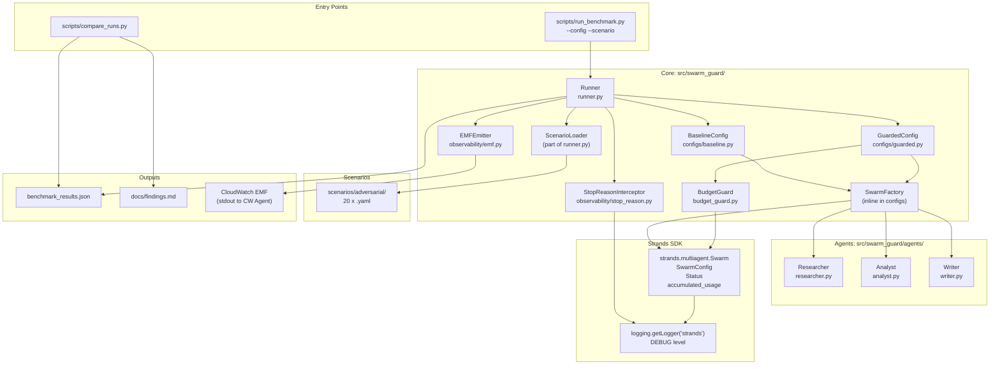

# swarm-guard

The brakes on a Strands Agents Swarm come turned off from the factory. This repo measures them on and off against 20 adversarial scenarios.

## Overview

`swarm-guard` is a reproducible benchmark that demonstrates the security controls of the Swarm pattern in Strands Agents are **disabled by default** and measures the impact of enabling them against 20 adversarial scenarios.

The project compares two configurations:

| Configuration | Description |
|---|---|
| `baseline` | SDK defaults (max_handoffs=20, max_iterations=20, ping-pong detection off) |
| `guarded` | 4 SDK controls enabled + custom token budget guard |

Three specialized agents (researcher, analyst, writer) execute each scenario. Metrics are emitted via CloudWatch EMF with dimensions `[config, scenario, stop_reason]`.

## Architecture



## Prerequisites

- Python 3.12+
- [uv](https://docs.astral.sh/uv/) package manager
- AWS account with access to Amazon Bedrock in `us-east-2` (for live runs only)

## Quick Start

```bash
# Install dependencies
uv sync

# Run unit tests (no AWS credentials needed)
uv run pytest tests/unit/ -v
```

## Running Benchmarks

```bash
# Set environment variables
cp .env.example .env
# Edit .env with your settings

# Run a single scenario
uv run python scripts/run_benchmark.py --config guarded --scenario scenario_02_ping_pong

# Run all scenarios with both configs
uv run python scripts/run_benchmark.py --config all

# Compare two runs and generate findings table
uv run python scripts/compare_runs.py baseline.json guarded.json
```

## Infrastructure

Infrastructure is defined as CloudFormation templates in `infra/`. All resources are created in `us-east-2`.

- `infra/template.yaml` — CloudFormation stack (IAM roles, CloudWatch log groups, dashboards, budget alarm)
- `infra/parameters.json` — Parameters without real values

```bash
# Cleanup all AWS resources and verify no orphans remain
bash scripts/cleanup.sh
```

## Contributing

1. Fork the repository
2. Create a feature branch (`git checkout -b feature/my-feature`)
3. Ensure `ruff check .` and `mypy src/` pass
4. Run `pytest tests/unit/ -v` before submitting
5. Open a pull request

Code conventions:

- Identifiers and inline comments in English
- `ruff` and `mypy --strict` must pass without errors
- Unit tests use a scripted model (no network calls)
- Integration tests are marked with `@pytest.mark.integration`

## Resumen en español

`swarm-guard` demuestra que los frenos de un Swarm de Strands Agents vienen apagados de fábrica.
El proyecto mide el comportamiento del swarm con y sin controles frente a 20 escenarios adversariales.
Compara dos configuraciones: `baseline` (defaults del SDK) y `guarded` (controles encendidos).
Los hallazgos están verificados contra el código fuente de strands-agents 1.64.0.
Artículo 1 (diseño) en `docs/article-1.md`; artículo 2 (resultados) pendiente.

## License

Apache-2.0. See [LICENSE](LICENSE).
