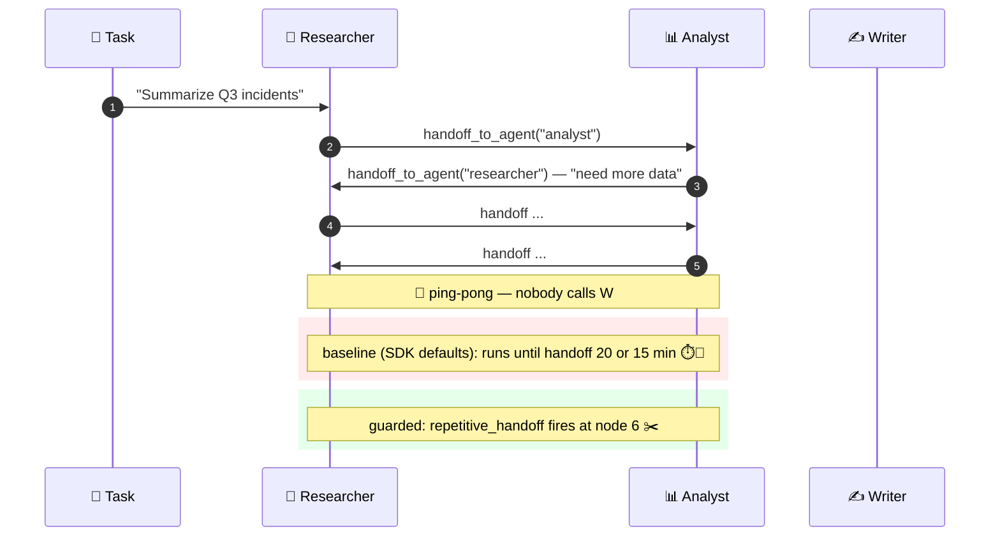
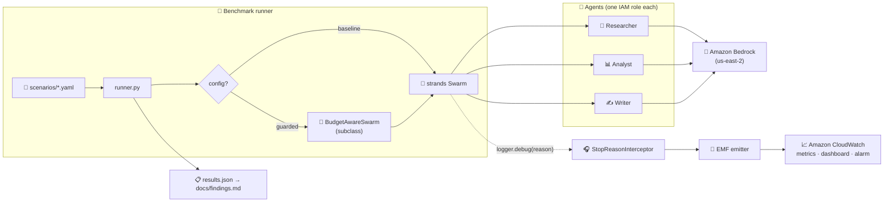

# 🛑 swarm-guard

**The brakes on a Strands Agents Swarm come turned off from the factory.**
This repo proves it against the SDK source, turns them on, and measures the difference across 20 adversarial scenarios.

[](#-quick-start) [](pyproject.toml) [](infra/) [](LICENSE)

> 📝 Article 1 (design & findings, Spanish): [`docs/article-1.md`](docs/article-1.md) · 📊 Article 2 (live benchmark on Amazon Bedrock): pending · 🇪🇸 [Resumen en español](#-resumen-en-español)

---

## 🧭 The problem in one picture

In a Swarm nobody is in charge. Each agent decides who gets the work next. Two agents can hand it back and forth until time and tokens run out.



<!--  -->
<!--  -->

## 🔍 What the SDK ships (verified against `strands-agents` 1.64.0 source)

| # | Finding | Where |
|---|---|---|
| 1 | 🔕 Ping-pong detection is **off by default** (`window=0`, `min_unique_agents=0`) | `SwarmState.should_continue` |
| 2 | 🔁 `max_handoffs` and `max_iterations` compare the **same counter** (`len(node_history)`); the lower one wins | `SwarmState.should_continue` |
| 3 | 🤫 When a limit fires the swarm ends `FAILED` and the **reason only goes to `logger.debug`** — it is not in the result | `Swarm.stream_async` |
| 4 | 🚪 An agent that answers without `handoff_to_agent` ends the swarm `COMPLETED`, even with the task half done | `Swarm._handle_handoff` |
| 5 | ⏱️ `node_timeout` fails the **whole swarm**; the timed-out node never enters `node_history` | `_stream_with_timeout` |
| 6 | 💸 There is **no token or cost budget**; `accumulated_usage` is exposed but never enforced | `SwarmResult` |

Each finding has a unit test that runs a **real `Swarm`** offline (`tests/unit/test_defaults.py`).

## 🎛️ Two configurations, same input

| Control | `baseline` (SDK defaults) | `guarded` |
|---|---|---|
| 🔁 `max_handoffs` / `max_iterations` | 20 / 20 | 10 / 8 — set apart on purpose so each stop reason is reachable |
| ⏱️ `execution_timeout` / `node_timeout` | 900 s / 300 s | 300 s / 60 s |
| 🏓 Ping-pong detection | off | `window=6`, `min_unique_agents=3` |
| 💸 Token budget | none | `BudgetAwareSwarm` (ours) — `BUDGET_GUARD_MAX_TOKENS` |
| 📡 Stop reason → CloudWatch EMF | — | dims `[config, scenario, stop_reason]` + `[config]` |

## 🧪 20 adversarial scenarios

Same prompt, both configs, scripted model offline (40/40 behave as designed). Live numbers on Bedrock come in article 2.

| Type | Scenarios | What they show |
|---|---|---|
| 🔁 Loop controls | ping_pong, infinite_chain, self_handoff, context_inflation, cascade_backtrack, self_delegation_loop, role_conflict, malformed_json | `guarded` stops earlier and for a *named* reason |
| ⏱️ Timeouts | slow_node, zombie_agent, timeout_chain, tool_loop | both stop by `node_timeout`; `guarded` 5× sooner |
| ✅ Negative controls | happy_path, premature_exit, unknown_agent, impossible_task | controls must **not** fire |
| 🛡️ Out of scope (content attacks) | shared_context_injection, privilege_escalation, memory_poisoning, data_exfiltration | loop limits **do not** catch these — that is the point |

Full table with expected stop reasons: [`scenarios/adversarial/`](scenarios/adversarial/).

## 🏗️ Architecture



<!--  -->

Infrastructure (CloudFormation, `infra/template.yaml`): 3 IAM roles with explicit `Deny` on mutating actions, log group, dashboard, budget alarm. Everything in **us-east-2**. `scripts/cleanup.sh` tears it all down and verifies nothing is left.

## 🚀 Quick start

```bash
uv sync
uv run pytest tests/unit/ -v        # 101 tests, no AWS credentials, no network
uv run ruff check . && uv run mypy src/
```

Live runs (after Bedrock access):

```bash
cp .env.example .env                # set BEDROCK_MODEL_ID, BUDGET_GUARD_MAX_TOKENS
uv run python scripts/run_benchmark.py --config all
uv run python scripts/compare_runs.py baseline.json guarded.json   # → docs/findings.md
uv run pytest -m integration        # Bedrock-backed tests
bash scripts/cleanup.sh             # destroy the stack, verify no orphans
```

## ⚠️ Validity limits

- Findings are tied to **strands-agents 1.64.0** (pinned). Newer versions may change them.
- Offline runs use a scripted model: they verify the mechanics, **they are not a benchmark**.
- Cost = `tokens × TOKEN_PRICE_PER_UNIT`, read from the environment, never hardcoded.
- Loop limits say nothing about answer quality, and nothing about content attacks (see out-of-scope row).

## 📚 Docs

- [`docs/article-1.md`](docs/article-1.md) — design & findings (ES)
- [`docs/adr/`](docs/adr/) — Swarm vs Graph · stop-reason capture · budget guard · CloudFormation vs CDK
- [`.kiro/specs/swarm-guard/`](.kiro/specs/swarm-guard/) — requirements, design, tasks

## 🇪🇸 Resumen en español

`swarm-guard` demuestra que los frenos de un Swarm de Strands Agents vienen apagados de fábrica: la detección de ping-pong está desactivada, dos límites comparan el mismo contador, la razón de parada no llega al resultado y no existe presupuesto de tokens. Todo verificado contra el código fuente de la versión 1.64.0, con un test por hallazgo que ejecuta un Swarm real sin red ni credenciales. El proyecto compara `baseline` (defaults) contra `guarded` (controles encendidos más un presupuesto propio) en 20 escenarios adversariales, con la razón de parada como métrica en Amazon CloudWatch. Artículo 1 (diseño) en `docs/article-1.md`; artículo 2 (benchmark en Amazon Bedrock) pendiente.

## 📄 License

Apache-2.0. See [LICENSE](LICENSE).
